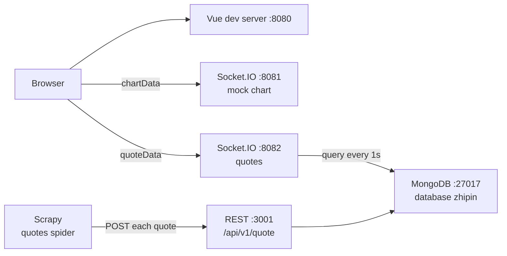

# Realtime Quotes Dashboard

A small full-stack demo by [fanqingsong](mailto:qsfan@qq.com): Scrapy crawls quotes, a REST API stores them in MongoDB, and Socket.IO pushes updates to a Vue page.

The page has two live panels:

- **Quotes list** — humor quotes from [quotes.toscrape.com](http://quotes.toscrape.com/tag/humor/), refreshed from MongoDB about once a second.
- **Technology bar chart** — Hadoop / Spark / Storm counts. These numbers are generated in memory and are not crawled.

There is no hosted demo. Run it locally and open `http://localhost:8080`.

**Stack:** Scrapy · Node.js · Express · Mongoose · Socket.IO · Vue 2 · MongoDB

## What this shows

- **Crawl to storage.** The `quotes` spider reads quote text and author, then POSTs each item to `POST /api/v1/quote`. The API is generated with `express-restify-mongoose` and writes to the `zhipin` database.
- **Server push.** The quotes WebSocket loads the `quote` collection about once a second and broadcasts `quoteData`. The browser subscribes; it does not poll.
- **Live Vue view.** `App.vue` opens two Socket.IO connections: port `8082` for quotes and port `8081` for the bar chart (`v-charts`).

## Architecture



| Port | Process | Role |
| --- | --- | --- |
| 8080 | Vue webpack dev server | Page |
| 8081 | `websocket_server_mock_data.js` | Pushes `chartData` |
| 8082 | `websocket_server_quotes.js` | Pushes `quoteData` from MongoDB |
| 3001 | `webservice_restify_quotes.js` | REST API used by the crawler |
| 27017 | `mongod` | Database `zhipin` |

## Docker Compose

```bash
docker compose up --build
```

Then open `http://localhost:8080`. The `scrapy` service runs once and posts quotes to the REST API. Stop the stack with `docker compose down`.

| Service | Host port | Role |
| --- | --- | --- |
| `frontend` | 8080 | Vue webpack dev server |
| `ws-chart` | 8081 | Mock chart Socket.IO |
| `ws-quotes` | 8082 | Quotes Socket.IO |
| `restapi` | 3001 | REST API |
| `mongo` | 27017 | MongoDB database `zhipin` |
| `scrapy` | — | One-shot quotes crawl |

Inside the compose network, Node services use `MONGO_URL=mongodb://mongo:27017/zhipin` and Scrapy uses `QUOTE_API_URL=http://restapi:3001/api/v1/quote`. Local `./bin/start.sh` still defaults to `localhost`.

## Quick start

Prerequisites:

- Node.js and npm (`package.json` declares Node `>= 6` and npm `>= 3`)
- MongoDB, with `mongod` on `PATH` and permission to use `/data/db`
- Python 3 with `scrapy` and `requests` for the crawler

```bash
./bin/install.sh
./bin/start.sh
```

`install.sh` runs `npm install` in the repo root and in `frontend/`, then `pip install -r requirements.txt`.

`start.sh` starts MongoDB, both WebSocket servers, the REST API, and the Vue dev server. Logs go to `logs/`.

Crawl quotes after the REST API is up:

```bash
./bin/start_scrapy.sh
```

Then open `http://localhost:8080`. The bar chart should move on its own. The quotes list fills in after the spider has posted items (the quotes server also inserts one sample quote, author `FQS`, on startup).

Stop MongoDB and every `node` process on the machine:

```bash
./bin/stop.sh
```

`stop.sh` uses `kill -9` on `mongod` and on all `node` PIDs. Do not run it if other Node apps should keep running.

| Command | What it starts |
| --- | --- |
| `./bin/start_mongod.sh` | `mongod` |
| `./bin/start_websocket_server.sh` | Chart server and quotes server |
| `./bin/start_restapi.sh` | REST API on port 3001 |
| `./bin/start_vuedev.sh` | Vue dev server |
| `./bin/start_scrapy.sh` | `scrapy crawl quotes` |

## Layout

```text
bin/                     start, stop, and install scripts
frontend/                Vue 2 + webpack dev server
  src/App.vue            chart + quotes list, two Socket.IO clients
backend/
  websocket_server_mock_data.js
  websocket_server_quotes.js
  webservice_restify_quotes.js
  data_access/           Mongoose connection and Quote model
  scrapy/scratch_zhipin/ Scrapy project (quotes pipeline, older zhipin spider)
```

## Scope

This is a demo of one data path, not a production app.

- Vue 2, Webpack 3, and Socket.IO 2.
- No login, tests, or deployment.
- The bar chart is mock data. It is not filled by the spider.
- `scratch_zhipin/spiders/zhipin_spider.py` is an earlier experiment and is not part of the running demo. `./bin/start_scrapy.sh` runs the `quotes` spider only.
- `requirements.txt` is a broad Python environment dump. Scrapy itself is not pinned there; install it separately before crawling.
